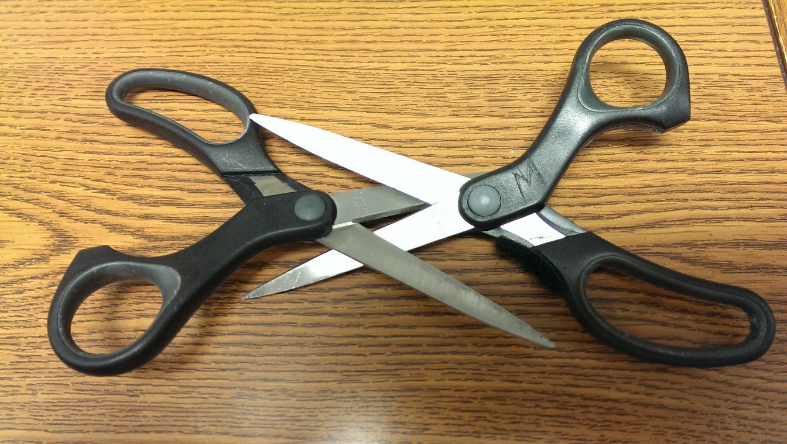
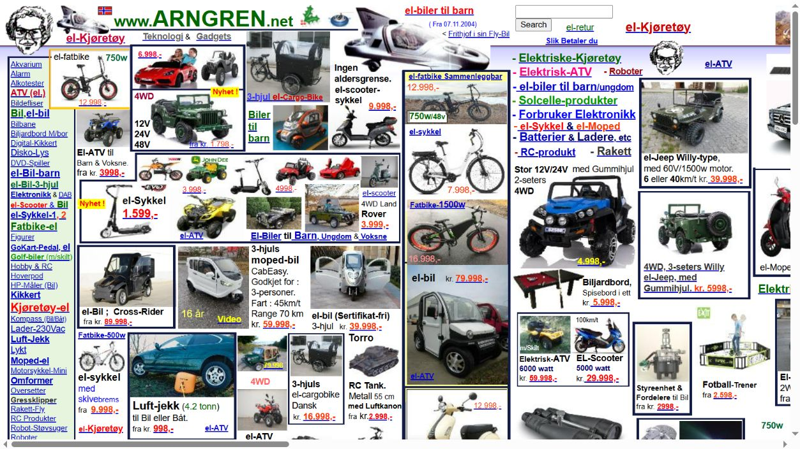
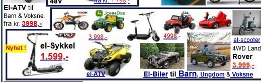

+++
title = 'Homework 1: The small decisions an interface makes for us'
draft = false
weight = 1
category = 'HCI / Homework 1'
description = 'Affordances, visual grouping, and two checkout patterns, with concrete redesigns.'
stage = 'Object photographs, two observed grouping cases and redesigns included'
+++

## Lecture 1 · What can I do with this object?

### A useful cue: scissor handles

The openings in these handles admit fingers, while their different shapes suggest a grip. One opening accommodates the thumb and the longer opening accommodates other fingers. The pivot links the hand's opening and closing movement to the blades. A label saying “hold here” would add little: the object already provides both a workable action and a clue to finding it.

This works for the basic cutting action, although hand size and left- or right-handed use still affect comfort. An easily recognised grip does not make every pair suitable for every person.

### An unclear orientation: the USB-A plug

The exposed metal end makes the insertion action fairly clear. Its rectangular outer shape gives less help with orientation. The internal insert is offset, so the plug fits a matching socket in only one orientation. That detail is harder to see when the socket is behind a computer or below a desk.

I would add a raised tactile mark on one face of the plug and a matching mark beside the socket. The mark should communicate the permitted orientation even when the connector is hard to inspect. A reversible connector is a larger redesign that removes the orientation decision altogether.

The distinction matters here. An affordance is the possibility of an action; a signifier communicates that possibility. The plug affords insertion and mechanically constrains the wrong orientation, while its exterior communicates that constraint poorly.

## Lecture 2 · When nearby things belong to the wrong group

Gestalt principles describe how people organise visual elements into groups. Proximity makes nearby elements seem related, while a common boundary makes enclosed elements seem to belong together. When those cues conflict with the information structure, readers have to work out which labels, images and prices belong together.

### Proximity: where does one product end?

Near the lower left, a bicycle listing sits beside a car-jack listing, whose picture also contains a car. The short gaps between adjacent listings compete with the spacing inside each listing. My first task is to work out which image, description and price belong together; comparing the products comes later. The problem is not simply that the page has many things on it. It is that distance supplies a weak answer to “which of these things form one item?”

I would keep each title, image, specification and price in one vertical stack, with a visibly larger gutter before the next product. The price should have a predictable position. These changes make proximity agree with the information structure.

### Common region: a frame that groups too much

This frame contains several small vehicles, several prices and a category link along its lower edge. The shared boundary makes the block look like one coherent unit, although the reader still needs to distinguish the individual offers. A large frame is doing the grouping work that the individual product boundaries should do. The category link is also visually close to the final row of products, which leaves its scope unclear.

I would give each offer its own card and place the category heading above the whole set. A card then means “one offer”; the heading means “the category containing these offers.” The [redesign study](../../../hci-assets/layout-study.html) shows the proposed spacing and product cards.

## Lecture 3 · A price that changes after the decision

Dark patterns steer people towards choices they may not intend. Hidden charges and preselected extras are two examples, illustrated by the archived checkout cases below.

**Hidden costs.** Harry Brignull's archived [123-reg example](https://old.deceptive.design/hidden_costs/) shows a monthly plan price changing when the user proceeds to an upgrade. The problem is the timing of disclosure: a person compares options using one figure, then meets a different figure after investing effort. My redesign would show the total charge, billing period and any known mandatory charges next to the initial offer. The final payment page should confirm the decision rather than introduce a new price.

**An unwanted extra already selected.** The archived [Travelocity case](https://old.deceptive.design/sneak_into_basket/) describes an optional product being included through a preselected choice. The opposite design would start with no optional extra, give the extra a price and a clear description, and update the total only after an explicit selection. Continuing without it should take the same number of steps.

These changes serve different purposes. The first makes comparison possible before commitment. The second makes an additional purchase depend on an intentional action. Giving every button the same colour would solve neither problem by itself.

