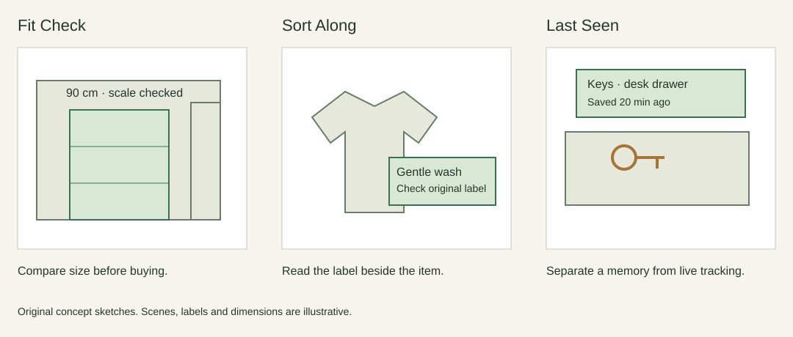

+++
title = 'Homework 3: Will this shelf fit?'
draft = false
weight = 3
category = 'HCI / Homework 3'
description = 'Three AR ideas, a placement prototype, and feedback on recovery and boundaries.'
stage = 'External try-out feedback and reflection added · proposed changes not yet retested'
+++

## Lecture 7 · Three ways to support an ordinary decision

**Fit Check.** Place a full-size outline of a shelf against a wall. Show its width, height and the gap to the door. It supports a spatial decision that is hard to make from a product photograph. A wrongly estimated scale is its main risk, so the interface needs a measurement check before presenting a confident result.

**Sort Along.** Show a short interpretation beside a garment's laundry symbol, then help group compatible items. This supports recognition and memory. It should preserve the original label and explain uncertain recognition rather than silently assigning a programme.

**Last Seen.** Save a user-confirmed location for an object and show a small marker when the user looks for it later. This supports memory, but the marker must say when it was saved. A stale record should not look like a live detection.

I chose Fit Check because the decision can be simulated with simple geometry. The first question is whether someone understands scale, clearance and the final state of the placement. Real room tracking can wait until those are clear.

## Lecture 8 · A first prototype

[Open Fit Check](../../../hci-assets/fit-check/index.html).

The prototype presents a schematic wall, a door and a shelf. A visitor can choose a shelf width, move it left or right, inspect the remaining clearance, and confirm or revise the placement. “Tracking lost” deliberately interrupts confirmation. Recovering requires checking the scale again; merely waiting does not restore certainty.

The browser prototype uses a schematic room and manual placement. It tests the interaction flow; camera tracking and real-world measurement are not implemented.

I kept the measurement visible even when the placement looks acceptable. Otherwise a green outline could encourage a person to ignore the numbers. The feedback uses text as well as colour, and the placement remains editable after confirmation.

## Lecture 9 · Feedback from the try-out

I asked someone else to try Fit Check. The feedback focused on two problems: the instructions for recovering from lost tracking were not direct enough, and the shelf could be moved beyond the wall. The points below paraphrase that feedback.

### Make the recovery action explicit

The prototype blocks confirmation when the scale is unverified, but the message does not clearly connect that state to the button needed to recover. Reporting the problem is only part of the job; the interface also needs to say what to do next.

I would change the message to “Tracking lost. Select ‘Check scale against 100 cm’ to continue” and highlight that button. Confirmation should remain unavailable until the scale check is complete. This would put the recovery action next to the explanation instead of leaving the user to infer the connection.

### Keep the shelf inside the wall

The position control currently keeps the same range when the shelf width changes. That allows a wider shelf to extend past the wall. A warning about the door does not prevent this separate placement problem.

I would limit the left-edge position to the wall width minus the selected shelf width, updating the limit whenever the width changes. The door-clearance check should remain separate: being inside the wall does not mean that the shelf leaves enough space beside the door.

### Reflection

Both problems concern what the interface leaves for the user to work out. Recovery needs a named next step, while placement needs a boundary that matches the object being moved. Showing a warning alone does not resolve either issue.

The next revision should test whether a person can recover without a hint and whether every shelf width stays within the wall. These are proposed changes; they have not yet been implemented or retested.
