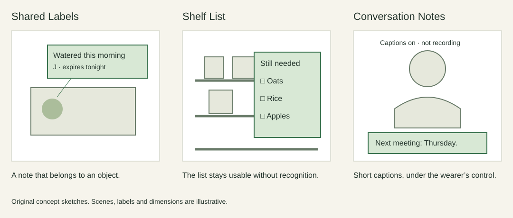

+++
title = 'Homework 4: When computing leaves the phone'
draft = false
weight = 4
category = 'HCI / Homework 4'
description = 'Phone shapes, Weiser’s everyday computing, and three proposed MR applications.'
stage = 'Reading and concept sketches drafted'
+++

## Lecture 10 · A shape follows the things we do

A phone with a physical keyboard gives typing a permanent place on its front. A touchscreen lets that same area change roles. It can be a map for one task and a keyboard for another. That flexibility helps explain the move towards a large, mostly uninterrupted display.

Size still involves a compromise. More space helps reading and selecting, but a larger object is harder to carry and reach across with one hand. Folding changes when that space is available. It also introduces a hinge, a crease and more decisions about how an application behaves as the device opens.

My prediction is a division of work rather than one final phone shape. The phone can remain useful for deliberate input, private reading and checking a detailed view. Glasses might handle a brief cue; a watch might handle a confirmation. That only helps if changing devices takes less effort than completing the task on the phone.

I do not expect a transparent display to make a phone disappear by itself. A person still has to read, select, correct and decide what other people can see. Those interactions put limits on how thin or visually unobtrusive a useful device can become.

## Lecture 11 · Reading Weiser in a room full of devices

In [*The Computer for the 21st Century*](https://modernmobile.cs.washington.edu/docs/21c.pdf), Mark Weiser describes computing embedded in familiar surroundings. Tabs, pads and boards offer different scales of interaction. The aim is to let people attend to their work, rather than to the equipment supporting it.

Parts of that world are already ordinary: small connected devices, shared displays and systems that respond to location. But the number of processors in a room is a poor measure of success. A room with many devices can still demand repeated pairing, account selection and attention to notifications.

What seems incomplete to me is dependable handover. Starting a task on one device and continuing on another often exposes the system's boundaries. The person has to decide where the current version is, which account is active and what has been shared.

I would judge an everyday computing environment by a mundane failure: can someone recover when the wrong display opens a document? Clear ownership, understandable sensing and a direct way to reverse an action would matter more than another automatic feature. Computing can become easy to overlook during normal use while remaining inspectable when it goes wrong.

## Lecture 12 · Three applications I would expect people to reuse

If MR headsets become as common as smartphones, these three applications could support everyday tasks.

**Shared Labels.** Attach a small note to a household object: “spare key inside” or “watered this morning”. It could reduce repeated questions between people sharing a space. Notes need an author, a last-updated time and a way to expire. Otherwise the room slowly fills with information nobody trusts.

**Shelf List.** Bring a shopping list into view beside the shelf, grouping items by what is still needed. It should work as an ordinary list when product recognition fails. I would keep offers and sponsored suggestions out of the task by default; help finding an item is different from persuasion to buy another one.

**Conversation Notes.** Offer optional short captions and a few user-saved names or terms during a conversation. The display should be easy to pause and should not cover the speaker's face. Recording and sharing need separate, clear choices. A useful aid must also be acceptable to the other people present.

I would expect Shared Labels to have the simplest repeated use and Conversation Notes to have stronger accessibility value. Shelf List depends more heavily on recognition and changing store layouts. Their usefulness would need to be tested in daily use.
