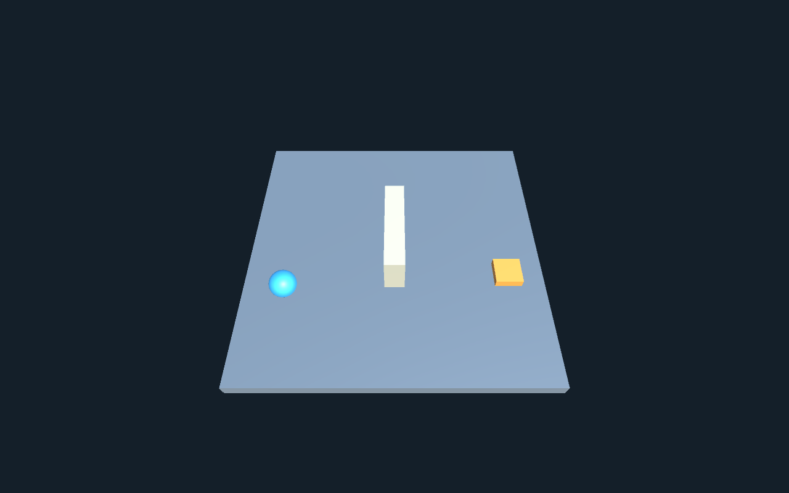

+++
title = 'Lab 1: Setting up the blog and Unity scene'
draft = false
weight = 5
category = 'HCI / Lab 1'
description = 'A Hugo course blog and the Sorting Yard Unity project.'
stage = 'Blog and Unity setup combined · desktop rendering verified'
aliases = ['/blog/hci/lab-1a-blog/']
+++

## Lab 1a · Blog setup

I used my existing [Hugo blog](https://tims-ansu.github.io/my-blog/blog/) for the coursework. The site runs on Hugo Extended 0.166.0. Each HCI post has its own folder under `content/blog/hci/`, containing an `index.md` file and its images.

The four homework posts follow Lectures 1–12. The practical posts cover the blog, Unity, ML-Agents, mobile input, Gaussian splatting and the talking character.

## Previewing the posts

I added the articles in Markdown and checked the headings, images and links in the local preview. Links use relative paths so they work under the site's `/my-blog/` directory.

I used `hugo server --buildDrafts --buildFuture` to review the pages locally, then included the reviewed articles in the published site. The article and course-list layouts omit dates.

## Lab 1b · Unity scene setup

I created **Sorting Yard** in Unity **6000.6.0f1**. The scene contains a floor, a blue sphere, an orange delivery dock and a central barrier. The goal is to move the sphere to the dock without leaving the floor.

Runtime scripts create the scene objects. The floor, barrier and sphere have colliders, and the sphere has a Rigidbody. The dock is a visual target, so the sphere can reach it without hitting a solid block. A fixed overview camera keeps the whole arena visible.

## Movement and controls

WASD or the arrow keys apply force in the X/Z plane. Damping reduces sliding, speed is limited, and rotation is frozen. Reaching the dock updates the delivery count and starts a new placement. Pause stops the simulation; Reset clears the current attempt.

*Standalone scene view; the interface is drawn separately.*

## Build fixes and result

The project uses ML-Agents 4.0.0. An obsolete `GetInstanceID()` call in its Match3 integration prevented compilation in this editor, so the embedded package uses `GetEntityId().GetHashCode()` for that fallback seed.

The first player also lost a shader that was referenced only by name. Saving a material asset and referencing it from the scene kept the shader in the build. The desktop player then started and rendered the scene successfully.
