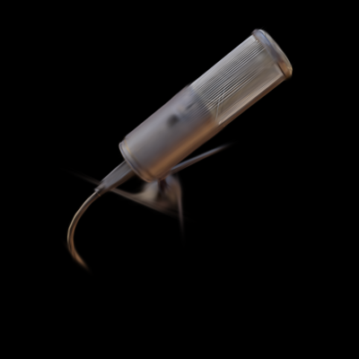

+++
title = 'Gaussian splatting: A microphone reconstructed from images'
draft = false
weight = 9
category = 'HCI / Gaussian splatting'
description = 'Training a microphone scene in Brush and displaying it in Unity.'
stage = 'Training and three Unity camera views verified'
+++

## Input and training

I used the **mic** scene from the NeRF Synthetic dataset: 100 training images and ten validation images, resized to 400 × 400 with alpha preserved. The input includes camera poses; this run does not include personal photography or COLMAP pose estimation. The original microphone model is [up3d.de's CC0 model](https://www.blendswap.com/blend/23295).

[Brush v0.3.0](https://github.com/ArthurBrussee/brush/releases/tag/v0.3.0) trained for 3,000 steps with spherical harmonics degree 3. Refinement ran every 100 steps, growth stopped at step 2,400, and checkpoints were exported every 1,000 steps.

| Checkpoint | Exported Gaussians | Mean validation PSNR |
| --- | ---: | ---: |
| 1,000 steps | 8,048 | 24.34 dB |
| 2,000 steps | 3,664 | 25.90 dB |
| 3,000 steps | 4,456 | 26.51 dB |

PSNR is the mean across ten validation renders, with the reference images composited over black. It measures the trainer's saved views rather than Unity rendering quality.

The body becomes recognisable, but the grille is blurred and parts of the stand and cable remain weak. The point count falls and then grows as refinement changes the representation.

## Unity display

I imported the final PLY into [aras-p's Unity renderer](https://github.com/aras-p/UnityGaussianSplatting), version 2.0.0. The player uses Direct3D 12, Linear colour and no MSAA. It loaded **4,456 Gaussians**, and I checked three supplied viewpoints.

The initial coordinate conversion mirrored the object. Converting both the camera basis and the model fixed the mismatch.

The Unity view preserves the broad shape and the same missing detail seen in training. A next run with a personally photographed object would add capture coverage, lighting and pose estimation to the workflow.
