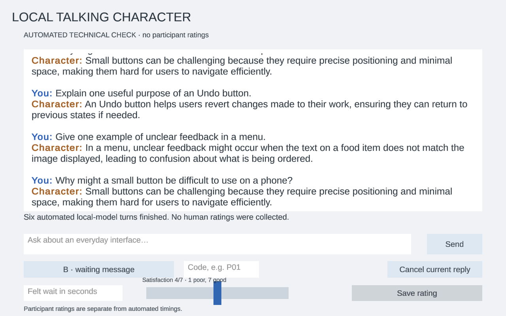

+++
title = 'Talking character: What happens before the first word?'
draft = false
weight = 10
category = 'HCI / Talking character'
description = 'A local chat character, response timing and waiting-state feedback.'
stage = 'Technical timing verified · qualitative A/B feedback and reflection added'
+++

## Local character and chat interface

I built a local chat character with Unity 6000.6.0f1, LLMUnity 3.0.3 and LlamaLib 2.0.5. The model is [Qwen2.5-0.5B-Instruct Q4_K_M](https://huggingface.co/Qwen/Qwen2.5-0.5B-Instruct-GGUF), running on six CPU threads with a 2,048-token context, temperature 0.2 and an 80-token output limit.

The scene has an input field, Send button and scrollable conversation. Sending disables the input until the reply finishes. Text streams into the current response, and controls unlock on completion or failure. The character is prompted to give short replies about everyday interface design.

The copied player initially failed to load its native library under a path containing Chinese characters. Changing the loader to the Unicode Windows entry point fixed it.

*Technical test run; the slider does not represent a participant rating.*

## Exercise 1 · Measure response time

The application records Send, first visible text and completion. I sent the same three prompts in each condition, clearing conversation history before each prompt and keeping the model loaded. All six turns completed.

| Condition | Completed turns | Median first text | Median completion |
| --- | ---: | ---: | ---: |
| A · no waiting message | 3/3 | 0.0919 s | 0.5409 s |
| B · waiting message | 3/3 | 0.0891 s | 0.4636 s |

The [timing records](technical-timings.csv) include the slower first turn in A. B ran later with caches already used, so this sequence checks the timing system and does not establish that the indicator changes model speed.

## Exercise 2 · Show the waiting state

Condition A streams the reply without an extra waiting message. Condition B shows “Preparing a reply…” until the first visible text. Model and generation settings stay the same.

The participant tries the same three prompts in both conditions. Each condition starts in a fresh application process, with an empty conversation and the same model-loading procedure. P01 tries A then B; P02 tries B then A, continuing that alternation for later participants. No artificial delay is added.

After each reply, the participant estimates the wait from Send to the first visible response text and gives waiting satisfaction from 1 (very dissatisfied) to 7 (very satisfied). The manual interface hides measured timings before the rating so they do not influence that estimate. The final question asks which condition made the application's state clearer, and why; “no noticeable difference” is a valid answer.

The [A/B worksheet](../../../hci-assets/evaluation/index.html#llm) records the prompts, individual turns and the final preference question. Technical timing is kept separate from feedback about the experience of waiting.

### Feedback from the comparison

Two responses came up repeatedly in the try-out feedback.

**B made the state clearer.** Seeing the waiting message helped people understand that the application had received the request and was preparing a reply. The benefit was acknowledgement: there was less uncertainty about whether pressing Send had worked.

**The difference was hard to notice when replies were fast.** Another recurring response was that the answer appeared so quickly that the waiting message barely registered. In those cases, A and B felt much the same.

These reactions concern different things. A message can make the system's state easier to understand without noticeably changing how long the interaction feels. They do not show that B makes the model generate faster, or that everyone prefers it. This is a qualitative comparison; no average satisfaction difference is established here.

### Reflection

I would keep a brief waiting message as immediate acknowledgement, but let it disappear as soon as the reply starts. Holding it on screen for a minimum duration would slow down a quick interaction just to make the indicator visible. A follow-up with genuinely longer requests would help check whether the acknowledgement remains useful during a more noticeable wait.
