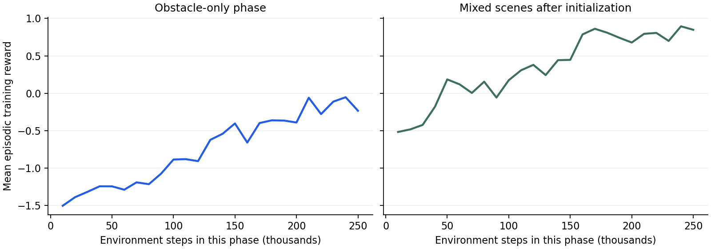

+++
title = 'ML-Agents: An easier scene the agent could not solve'
draft = false
weight = 7
category = 'HCI / ML-Agents'
description = 'Barrier navigation, mixed-scene training and 500 evaluation trials.'
stage = 'Two training phases and 500 evaluation episodes recorded'
+++

## Agent and environment

I extended Sorting Yard with a barrier across the direct route to the dock. The agent controls the sphere through two continuous actions, applying force along X and Z.

Its ten observations describe target-relative position, velocity, local position, barrier-relative position, whether the barrier is present, and target distance. Reaching the dock gives +1; falling off gives −1. Distance progress supplies an intermediate reward, with small costs for time and barrier contact. An episode lasts at most 500 physics steps.

The training setup uses Unity 6000.6.0f1, ML-Agents 4.0.0, Python ML-Agents 1.1.0, Python 3.10.12 and PyTorch 2.2.2 CPU. The native communication library failed under a path containing Chinese characters; an ASCII drive alias allowed the player to connect to the trainer.

## Training

The first PPO run used twelve parallel arenas, two hidden layers of 128 units and 250,000 steps. Every episode contained a barrier. It completed 41/100 barrier trials but none of the 100 open-floor trials. Although removing the barrier made the route simpler, the agent had never encountered a barrier-present flag of 0 during training.

I continued from that model for another 250,000 steps. This time each episode enabled or removed the barrier with probability 0.5, while the goal and action space stayed the same.

*Each panel shows its own training phase. Reward values are not completion rates.*

## Evaluation

The exported policies ran in the standalone Unity player with deterministic CPU inference. Each condition used 100 episodes from the same sequence of random starting positions, generated with layout seed 11082026. These are 100 layouts, not 100 repetitions of one fixed placement. The seed was separate from training, but only one evaluation seed was used.

| Controller | Barrier | Open floor |
| --- | ---: | ---: |
| Random actions | 0/100 | Not tested |
| Initial obstacle-only policy | 41/100 | 0/100 |
| Final mixed-scene policy | 48/100 | 100/100 |

The [evaluation summary](evaluation-summary.json) and [final barrier trials](mixed-obstacle.csv) include failures and timeouts in the totals.

Mixed training resolved the open-floor failure on this layout seed. The barrier remains difficult: the final policy failed more than half the attempts. Further training should vary barrier geometry and test new seeds. The player retains a manual/policy switch and Reset so a person can take over when the agent gets stuck.

## Interpreting the result

The raw CSVs confirm the totals in the table. All 52 failures of the final barrier policy ran close to the 10-second simulation limit. That points to unfinished attempts rather than a dependable route around the obstacle.

The old policy's 0/100 on open floor has a concrete warning sign in the saved model. The barrier flag was nearly constant during training: its normalizer mean is 0.99998 and its variance is about 0.000008. Changing the flag to 0 produces a normalized value of roughly −354, clipped to −5. With mixed training, the absent-barrier value becomes about −1.86. The new condition therefore changes the input the old network sees much more sharply than removing a physical obstacle might suggest.

This supports a distribution-shift explanation; it does not prove that normalization alone caused every failure. Unity's [ML-Agents overview](https://github.com/Unity-Technologies/ml-agents/blob/develop/com.unity.ml-agents/Documentation~/ML-Agents-Overview.md) also describes how policies can fail to generalise to changed environments. The [checkpoint and CSV audit](result-audit.json) records the calculations.

The increase from 41 to 48 barrier successes is seven additional successes on this layout sequence. It is a useful local result, but one training run and one evaluation seed do not establish reliable performance. Likewise, 100/100 on open floor means all of these tested episodes succeeded, not that future episodes are guaranteed to succeed.
