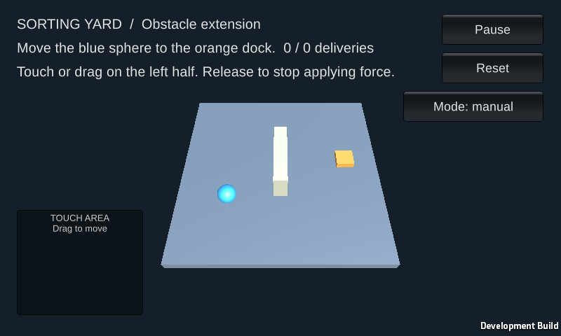

+++
title = 'Mobile: Giving the delivery task a thumb control'
draft = false
weight = 8
category = 'HCI / Mobile lab'
description = 'Touch movement, two-finger controls and Android emulator testing.'
stage = 'Android 15 deployment checked · 12 core and 5 two-finger checks passed'
+++

## Touch controls

I replaced keyboard movement with a touch area on the left half of the screen. Touching establishes an origin; dragging controls direction and strength, clamped to a unit circle. Releasing clears the input.

The first movement finger owns that input. Pause, Reset and the manual/policy switch sit on the right. Reset clears movement and requires a new drag. Returning from the background leaves the scene paused until Resume is pressed.

## Fixing two-finger input

Single-finger movement and button taps worked, but holding movement while tapping Pause with another finger did not. Unity received both contacts; the IMGUI button was relying on a simulated mouse click.

I added a secondary-finger handler that activates a button only when the finger is released inside the control it pressed. Cancelled touches do nothing. Pause, Resume and Reset then worked while the movement finger stayed down. Reset also prevented that held finger from restarting movement.

## Android deployment

I built an ARM64 APK with Unity 6000.6.0f1, Android Build Support, OpenJDK 17 and NDK r27c. The Android project uses ML-Agents 4.1 to resolve an IL2CPP compatibility issue. Runtime-created collider and renderer types also needed linker preservation.

The APK ran in an Android 15 / API 35 emulator with ARM64 translation, acceleration and host OpenGL ES 3.1 rendering at 800 × 480.

| Check | Result |
| --- | --- |
| Install, startup and cold relaunch | Landscape scene starts; cold relaunch returns to manual input. |
| Drag and release | The sphere moves; release clears held input. |
| Pause and Resume | Physics stops and restarts. |
| Reset | Placement changes and movement clears. |
| Background and return | The scene returns paused without held input. |
| Trained policy | The sphere moves without touch input. |
| Two fingers | The second finger can Pause, Resume and Reset during a drag. |

The [runtime checks](runtime-checks.json) passed all 12 core checks, and the [two-finger checks](multitouch-check.json) passed all five checks. These used injected input in the emulator. Physical-phone handling and sustained performance remain untested.
